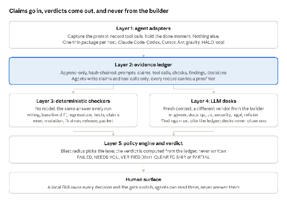

# Verdict: one verification tool for AI-driven development (design)

Oct 26, 2026 · @Scott Converse

## Summary

Verdict (working name) is one open-source tool that replaces dev-rigor-stack, proof-gate, sixdesk, gauntletgate, audit-team, coder-tdd-qa's release gate, prover and the two hook kits, and absorbs what malveon does well. It enforces a single rule structurally rather than in prose: **the agent writes claims, never verdicts.** Claims land in an append-only evidence ledger; verdicts come out of the ledger from things that are not the builder: deterministic code, a model from a different vendor, or the human.

The design has five layers. Thin per-agent adapters capture prompts, tool calls and the "done" moment. An evidence ledger records everything with a proof tier. Deterministic checkers (no model) and LLM desks (fresh context, other vendor) both read the ledger and append findings. A policy engine picks the lane by blast radius and issues a one-word verdict. A GUI owns every decision that is the human's.

The reason to build it: the current skills drifted apart because the discipline lived in six prose files copied between repos (the sixdesk vs stack contradictions documented in the [lineage check](https://claude.ai/artifact/4eYiXRrpe3XPv7VwWUYnf4)), and the mechanical floor (malveon) is closed where it matters most. Here the discipline lives once, in a policy file and a ledger schema, and every skill and hook is generated from it.

## Goals and non-goals

The tool exists for one person directing several AI coding agents from several vendors, with human oversight and no terminal.

**Goals**

- Make it structurally impossible for a builder to grade its own work: the agent cannot write a verdict, close a finding, or edit the ledger.
- One source of truth for the discipline (policy file plus ledger schema); every host's skill file and hook is generated from it.
- A deterministic floor that costs no tokens and gives the same answer every run, under the judgment layer.
- Cross-vendor verification enforced by policy: the verifier is never the builder's vendor above low blast radius.
- Every finding carries a proof tier and an evidence pointer; the report always lists what was not established.
- The human owns a short list of decisions through a GUI, never through the agent's chat.
- Fully open source (Apache-2.0), including every checker, so the tool can pass its own gate.

**Non-goals**

- Proving business logic is correct. The tool proves wiring, execution results, and claim-versus-code agreement; a desk may raise a logic concern, but only as a hypothesis.
- Replacing the agents' own test running. The exec runner invokes the project's defined commands; it invents none.
- A hosted service, account, or telemetry. Everything runs on the user's machine and sends nothing.
- Locking an agent out. Hooks are a speed bump by design; an agent with a shell can always write a file. The ledger records that it did, which is what the verdict needs.

## Architecture at a glance



The ledger is the hub. Adapters feed it; checkers and desks read it and append findings; the policy engine computes a verdict from it; the human closes what only a human may close.

## Target projects and their stacks

The tool is built for these repositories first, read on October 26, 2026 (shallow clones; manifests, CI workflows, scripts and READMEs read; application code not audited). None of them uses Next.js, Supabase, Prisma or Drizzle, so malveon's sweet spot was never this portfolio's, and the first extractors are Python and TanStack, not Next.js.

| Project | Stack | Tests and gates already there | What Verdict adds |
| --- | --- | --- | --- |
| [townlight](https://github.com/townlight) org: Core, Records (sunshine), Meetings, Code (ordinances), Zoning, Planning, Notice, Access shipped; Permit and Inspect in progress; 30 repos in all | Python 3.11/3.12, FastAPI, SQLAlchemy and asyncpg, Alembic, PostgreSQL 17 with pgvector and PostGIS, Celery and Redis; a shared `civiccore` wheel pinned by sha256 in every product's CI; React, Vite and TypeScript frontends (sunshine, meetings, ordinances) with openapi-typescript clients; a Tauri (Rust) desktop shell; signed Windows MSI | pytest, ruff, Playwright, vitest and axe per product; a hand-written `verify-release.sh` per product asserting version surfaces; `verify.yml`, `cleanroom.yml`, `release-preflight.yml`, `release-lockstep-gate` (release-truth files move together) and `verify-suite-state.py` (pins, versions, releases) in the umbrella | Wiring across FastAPI routes, SQLAlchemy writes and the generated TS client; Tauri `invoke` to `#[tauri::command]` wiring; a suite lane that reads the civiccore pins and product versions across repos; claims-vs-code on the release acceptance documents |
| [civiccast-native](https://github.com/scottconverse/civiccast-native) | Python 3.12 with FastAPI, Starlette and Typer; uv and hatch; a React and TypeScript operator UI; 91 PowerShell scripts; one Rust tool (NDI sender) | 30 GitHub workflows: ci-test, ci-lint, ci-policy-gates (`scripts/policy/*.py`), deterministic-detectors (randomized suite, informational; mutation job removed by owner on October 22), a11y, security scan, VM cleanroom release, soak runs, loudness and PDF compliance | Wiring for FastAPI and Typer commands; exec runner invoking the Makefile and policy scripts with tiers; release coherence reading the cleanroom artifacts rather than rebuilding them |
| [TownReporter](https://github.com/scottconverse/TownReporter) | TypeScript, TanStack Start, Router and Query, Vite SSR, Kysely over PGlite and pg, Radix UI, 151 SQL migrations; bundles the civic-scanner and report-local-news skills | Bespoke proof scripts in `package.json`: `check:auth` (loads /login in a browser and asserts the form), `check:panels`, `test:sources` ("sources reach the reader"), `proof:search`, `smoke`, lifecycle, flows and security-header e2e; `ci.yml` and `windows-install.yml` | Wiring for TanStack server functions and Kysely writes; those proof scripts registered in the policy as exec commands at the `browsed` tier, so a clean run can say "the login form rendered" with evidence instead of "tests passed" |
| [siftwing](https://github.com/scottconverse/siftwing) | TypeScript on Node: CLI and MCP server (`@modelcontextprotocol/sdk`), playwright-core, zod and ajv; a Python SDK | `test`, `check`, `quality:retained` scripts; `test.yml`, `pages.yml` | Wiring for MCP tool registrations (a claim that tool X exists and calls Y); exec runner |
| [textflowkit](https://github.com/scottconverse/textflowkit) | Python 3.10+, hatch, ruff, pytest; CLI, MCP server and FastAPI HTTP API; PyPI release | `ci.yml`, `publish-pypi.yml` | Wiring for FastAPI and MCP tools; release coherence against the PyPI version |
| [dsh-halo-research](https://github.com/scottconverse/dsh-halo-research) (private) | DeepSeek Harness Web 0.2.1-rc.3 and Desktop on the Strix Halo Windows box; Ollama cloud default plus local LM Studio and Ollama; native plugins (model\_route), skills, MCP (XERJ); Mission Control; mostly PowerShell and dated evidence documents | No CI. Prior gate experiments in `stack/`: `gatecheck`, `Check-Done.ps1`, `Gate-Build.ps1`, `halo-verified-coder`, `halo-policy-deterministic` | A DSH adapter so Verdict runs as a DSH plugin plus MCP server, which is the planned port; the HALO local models become the cross-vendor verifier for cloud-built work |

Two facts from the read shape the design more than the framework list. First, every repository is Windows-first in practice (signed MSIs, PowerShell launchers, `.cmd` installers) while CI runs on Ubuntu, so the exec runner must run PowerShell scripts natively on Windows and the tool must not assume WSL. Second, the projects already carry hand-written deterministic gates (version-surface assertions, lockstep checks, policy scripts, browser probes), so the release and firstrun checkers wrap those scripts and record their results with a tier, instead of reimplementing them; Verdict's own generic checks apply only where a repo has none.

## Layer 1: agent adapters

Adapters are the only vendor-specific code in the tool, and each one does exactly three things. Everything else an agent needs goes through the MCP server, which is vendor-neutral.

| Job | Hook event (Claude Code name; each host has an equivalent) | What is written to the ledger |
| --- | --- | --- |
| Capture the prompt | UserPromptSubmit | The prompt word for word, timestamp, agent name, model name, session id. The first prompt of a session also writes the baseline snapshot. |
| Record tool calls | PostToolUse on edit, write, shell, browser and run tools | Tool name, target file or command, output hash. Never the content of the output; the hash is enough to prove it happened. |
| Hold "done" | Stop (and the pre-edit hook in enforce mode) | The agent's final message, then the gate result. In enforce mode a red gate sends the agent back with the finding list, at most twice, then releases and tells the human. |

**Hosts in scope:** Claude Code, Codex, Cursor, Antigravity, and DeepSeek Harness (DSH) on the HALO workstation, where the adapter is a native DSH plugin and the MCP server is the primary path; DSH is also the planned home for the tool's own future port as plugins. Each adapter lives in its own package with its own payload fixtures taken from that host's documentation, and a parity test that asserts the ledger records it writes are identical across hosts for the same event. Starting point: claude-hook-kit's ran-before-done and codex-hook-kit, trimmed to the three jobs.

**MCP server.** Exposes `verdict_check`, `verdict_scan`, `verdict_claim` (the agent records what a prompt asked for, one checkable line each, naming a URL, file or symbol), `verdict_done_when` (for a vague prompt, the agent states how the human will know it is done; "it works better" is refused because it cannot be wrong) and `verdict_decisions` (lists the human's open decisions; the agent can read them, never answer them). The server returns the same report the GUI shows, verdict line included.

**Shadow mode is the default.** A fresh install holds nothing; it writes what it would have held to the ledger and the GUI shows it. Enforce mode is turned on per project in the GUI, after the human has seen shadow output. Only the human can switch modes; the switch is not reachable through MCP or any hook, and every change is a ledger record.

**Fail open.** If the adapter crashes, times out (20 seconds on Stop), or cannot find the core, the agent continues and the ledger gets a `check_unavailable` record. The verdict then reads unverified for that session, never clean.

## Layer 2: evidence ledger

The ledger is the core: an append-only, per-project record that every other layer reads and only the core may write. It is what turns "worker is not the judge" from a request into a property.

**Storage.** SQLite file at `.verdict/ledger.db` in the project (ignored by git), with a JSONL export for diffing and for prover-style packets. Each record carries a monotonic sequence number and a hash chain over the previous record, so a tampered or truncated ledger is detectable (the TamperCheck idea, built in). The baseline snapshot is a git tree hash plus a content hash of uncommitted files, never a copy of the code.

**Record types**

| Record | Written by | Holds |
| --- | --- | --- |
| session | adapter | start time, baseline hash, agent, model, vendor, policy version |
| prompt | adapter | the prompt verbatim, ordinal |
| claim | agent via MCP | source (plan line, prompt translation, done\_when, final message, commit message, notes file), text, the URL/file/symbol it names |
| tool\_call | adapter | tool, target, output hash, duration |
| check | core | checker or desk name, tier, inputs hash, started/finished, outcome (ran, failed\_to\_run, skipped\_by\_policy) |
| finding | checker or desk | id, severity, title, claim it bears on, evidence pointers, tier, blast, `judgment` flag if from a desk, fix hint |
| decision | human via GUI | which decision, the choice, who (always the human), timestamp |
| verdict | core | the word, counts by tier, the not-established list, policy version |

**Proof tiers** are an enum on every check and finding, taken from sixdesk and made mechanical:

- `static`: a file was read
- `ran`: a command the project defines was executed; output hash recorded
- `browsed`: a page on a server the tool started was loaded; screenshot hash recorded
- `asset`: a release artifact was listed or hashed
- `judgment`: a desk's reasoning, citing ledger evidence
- `honest_red`: required, could not run, reason recorded
- `unverified`: not required in this lane, or not possible, nothing checked

**Rules that make the ledger trustworthy**

- Append only. No record is ever updated or deleted; a correction is a new record that references the old one.
- Agents write claims and tool calls only, through the adapter or MCP. An agent call that tries to write a finding, decision or verdict is refused and recorded as a refused write.
- A finding without an evidence pointer is stored as a hypothesis, not a finding, and never counts toward or against a verdict.
- Evidence pointers are file:line with a content hash of that line, or a command plus output hash, or an asset hash. A pointer whose hash no longer matches the tree is shown as stale in the GUI.
- The ledger is per project and per machine. Cross-machine continuity (the stack's decision log) is a separate exported `decisions.jsonl` the project may track in git; the ledger itself is never committed.

## Layer 3: deterministic checkers

Checkers are plugins with no model in them. Each reads the ledger and the working tree, appends findings with a tier and an evidence pointer, and ships with mutation fixtures that prove it can go red. Same inputs, same findings, every run.

| Checker | What it proves | Tier | Blocks? | Origin |
| --- | --- | --- | --- | --- |
| wiring | For each claim naming a URL, file or symbol: CONNECTED, BROKEN, NOT BUILT, HALF BUILT or SKIPPED, with the page → call → route → data-change path | static | BROKEN, NOT BUILT, HALF BUILT on ticked items | own implementation on tree-sitter; malveon's five verdict words kept, none of its code |
| baseline\_diff | New routes, pages, tables, packages and data-changing buttons nothing the human wrote asked for; files nothing points at | static | never; forces NEEDS YOU | malveon's closed check, rebuilt open |
| regressions | Calls that reached a route at baseline and reach nothing now; imports that resolved and don't; a named catalog of bug patterns added this session (empty catch, leftover debugger or .only, hard-coded secret, bare except) | static | always | malveon's closed check, rebuilt open |
| tests\_weakened | Test files deleted or commented out, assertions removed, assertions on constants; cleanup detection when the tested file went too | static | never; forces NEEDS YOU | malveon's closed check, rebuilt open |
| claims\_vs\_code | Every claim from a final message, commit message or notes file that names something: looked up like a plan line; a contradiction blocks | static | contradiction blocks | malveon's agent's-words check, rebuilt open |
| unfinished | TODO/FIXME, not-implemented bodies, sample data, debug logs, commented-out code, skipped tests, in lines added this session; a called stub blocks | static | called stub only | malveon, rebuilt open |
| exec | The project's own build, lint, typecheck, test and proof commands, each registered in the policy with the tier it earns (a pytest run is \`ran\`; TownReporter's check:auth, which loads /login in a browser, is \`browsed\`); PowerShell scripts run natively on Windows; on failure, re-run on a temp copy of the baseline to say whether this session broke it | ran | failure blocks | malveon --exec plus the stack's baseline re-run idea |
| mutation | deterministic-detector run on changed logic, only where policy says (Critical changed logic or test-sensitivity uncertainty); survivors recorded with seeds | ran | per policy | deterministic-detector |
| firstrun | Where the repo has its own cleanroom workflow (townlight's cleanroom.yml and installer-cleanroom, civiccast's vm-cleanroom-release) the checker runs or reads it and records the artifacts; otherwise, in a container: fresh profile, every external dependency absent, then present, the documented first-run path walked on a server the tool started; either way the attestation links to screenshot and log hashes | browsed | dead-end on core feature blocks at release | gauntletgate walkthrough lane |
| release | Runs the repo's own release-truth scripts first (townlight's verify-release.sh, verify-release-lockstep.py and verify-suite-state.py; civiccast's policy scripts) and records each with its tier; then the generic checks where a repo has none: HEAD vs latest tag vs release body vs assets, asset hashes, package name vs product name, lockfile vs manifest, in-tree markdown 404s, README commands exist. In suite mode it also checks that every member's pinned shared-library version (civiccore sha256) and product version agree with the umbrella's release record | asset, static | mismatch blocks at release | sixdesk Pack E and Pack C |
| packet | Renders the ledger for a session or release as a self-contained acceptance document: proven, failed, unproven, out of scope, each with evidence | n/a | n/a | prover |

**Plugin contract.** A checker is a module exporting `name`, `tiers`, `applies(policy, lane)`, `run(ledger, tree, opts) → findings[]`, and `fixtures/` holding at least one project where the checker must go red and one where it must stay green. CI refuses a checker whose red fixture passes. Checkers never call each other; ordering is the core's job (wiring before claims\_vs\_code, exec before mutation).

**Scan without a plan.** `verdict_scan` runs wiring, regressions and unfinished against the whole tree with no session or claims, exits 0, writes nothing. It is the first thing to run on a repo nobody has set up.

**Framework coverage** is built in the order the target projects need it, each extractor a tree-sitter query set with its own red and green fixtures: (1) FastAPI routes with APIRouter prefixes and include\_router, SQLAlchemy and asyncpg writes, Alembic migrations; (2) TypeScript fetch calls, openapi-typescript generated clients, TanStack Start server functions and Kysely writes; (3) Tauri \`invoke\` calls to \`#\[tauri::command\]\` handlers; (4) Typer CLI commands and MCP tool registrations in both Python and TypeScript, treated as routes so a claim can name a command or tool; (5) React buttons and forms. Next.js, Supabase, Prisma and Drizzle are not on the list because no target project uses them. A stack the wiring checker does not read is reported as `unverified` for wiring, never as clean.

## Layer 4: LLM desks

Desks are the only place a model is allowed, and they are workers over the ledger, never over the builder's notes. They add judgment the checkers cannot: is the logic right, is the UX coherent, is the security posture sound, do the docs overclaim, is there a legal or licensing problem.

**The desks** are sixdesk's six plus proof-gate's refuter, each with a rubric file in the repo (`desks/<name>.md`) that is the generated, versioned source the worker is handed; a rubric is never recalled from memory.

| Desk | Hunts for | Reads |
| --- | --- | --- |
| Engineer | Architecture, correctness, performance, dependency risk | tree, wiring findings, exec output hashes |
| Docs | README, manual and landing claims the code does not back; commands that do not exist | tree, claims\_vs\_code findings, release findings |
| QA | Runtime behavior across layers; what the tests prove versus claim | exec and firstrun records, tests\_weakened findings |
| UX | First-run dead ends, inert controls, empty and error states | firstrun screenshots, wiring paths |
| Security | Secrets, auth boundaries, injection, dependency advisories | regressions findings, tree |
| Legal | Licenses of dependencies, vendored code, trademark and privacy claims | manifests, LICENSE files, release findings |
| Refuter | Tries to break every CONNECTED and every clean exec result | the full ledger |

**What a desk may do**

- Append findings tagged `judgment`, each citing at least one ledger record or evidence pointer. A finding with no citation is stored as a hypothesis and routed to a checker or to the human; it never moves the verdict.
- Propose a mutation or a firstrun cell to run. The core runs it as a checker; the desk does not run code.
- Dissent. Desks are independent; the coordinator never averages them. Both findings stay, and the report shows the tension.

**What a desk may not do**

- Close, downgrade or resolve a finding. Closing takes a checker result or a human decision.
- Read the builder's final message, notes or commit messages except as claims already in the ledger. The refuter is told to refute, not confirm, and starts from the ledger alone.
- Answer a human decision, switch the gate mode, or edit the policy.

**Cross-vendor routing.** The policy names the builder's vendor per session (from the adapter record) and the core picks desk workers from a different vendor: Claude builds, Codex or a HALO local model verifies; Codex builds, Claude verifies. Above low blast radius this is a hard refusal: a verdict is not issued if builder and every desk share a vendor. Routing goes through the existing multi-model-routing skill's receipt mechanism so the ledger records which model actually answered.

**Cost discipline.** Desks run only in the lanes policy assigns them (none in low; Engineer and QA in standard; Engineer, QA, Security and the refuter in high; all seven in release), and each desk is capped at five findings in the report body with the remainder counted. The coordinator model does no verification itself; its job is dispatch and merge, exactly as the stack's Workflow-tool rule required.

## Layer 5: policy engine, verdict and human surface

The policy engine decides what runs; the verdict is computed, never written; the GUI is the only place a human decision can be made.

**Policy engine.** On every check it classifies the session's blast radius from the ledger (files touched, whether any touches auth, data writes, migrations, public routes, release files) into low / standard / high / release, then selects the lane: which checkers, which desks, whether mutation and firstrun run, and what the verdict bar is. Classification is by what the diff touches, never by diff size and never by a label the agent supplies. The human can raise a lane in the GUI, never lower it below what the diff implies.

**Verdict computation.** One word from the ledger alone:

- `FAILED`: a blocking finding exists (BROKEN, NOT BUILT or HALF BUILT on a ticked claim; a regression; a contradicted claim; a called stub; a failed exec; at release, any finding above minor or a firstrun dead end).
- `NEEDS YOU`: nothing proven wrong, but something is the human's to settle: unplanned work, weakened tests, untranslated or vague prompts, a desk hypothesis, a check that could not run.
- `VERIFIED`, always suffixed by the highest tier reached: `VERIFIED (static)`, `VERIFIED (ran)`, `VERIFIED (browsed)`. The suffix is mandatory so a static-only clean run can never read as a tested one.
- `CLEAR TO SHIP`: release lane only, zero findings above nit, firstrun attested, release coherence clean, and every `ran` result that counts as proof has a mutation record where policy required one, and no commit-anyway override is open.

A lane that did not run a required checker is `PARTIAL`, never any of the above.

**Overrides.** Every stop has a logged way past it, and no override changes a verdict. Shadow mode, the default, holds nothing until the human turns enforce on. Accepting a finding as not real closes that one finding. Pause stops the gate for a stated duration. The cross-vendor refusal can be set to warn-only in the global policy, never per project. Each of these writes a decision record.

The pre-commit gate also has **commit anyway**, under four conditions:

1. Human-only. It lives in the GUI and the `vdt` command line, never in MCP or a hook. An agent call that tries it is refused and recorded as a refused write.
2. It writes a decision record with a reason the human typed, like every other decision.
3. The commit goes through, but the verdict stays `FAILED`. The `FAILED` verdict and the override travel together into the packet, so the acceptance document shows the commit and why it went through.
4. An open override blocks `CLEAR TO SHIP`. The human can commit past a finding, but cannot ship past it without resolving it or accepting it as not real.

`fixtures-red-must-fail` has no override. It guards the tool's own checkers, and nothing legitimate is on the other side of it.

**Human decisions.** The policy enumerates them; the GUI presents them; nothing else can answer them. The list is the stack's owner-decision principle made concrete: a decision is the human's when it is irreversible, crosses a trust boundary, or spends something the agent was not given.

| Decision | Asked when | Default if unanswered |
| --- | --- | --- |
| Which file is the plan | more than one candidate | none; check runs plan-less and says so |
| Run the project's commands | first exec in a repo, or after malveon.json-style config changes | do not run; exec reads honest\_red |
| Install hooks in this project | first check in a repo with an agent folder | not installed; recorded |
| Shadow or enforce | any time | shadow |
| Accept a prompt translation about something the human did not type | the agent's claim lines name a URL or file absent from the prompt | prompt stays NEEDS YOU |
| Withdraw a prompt the human cancelled | the agent proposes it | prompt stays active |
| Waive words no check can cover ("faster", "nicer") | the human reads the report | words stay listed |
| Accept a finding as not real (false positive) | any finding | finding stays open |
| Commit anyway past a FAILED pre-commit gate (with a typed reason) | the gate holds a commit in enforce mode | commit held; verdict stays FAILED either way |
| Raise the lane | any time | policy's classification |
| Tag a release | release lane clean | nothing; the tool never tags |

**Human surface.** A local web app served by the core on localhost (so it works in any browser and inside a VS Code or Cursor panel) with no terminal step after install. Panels: the verdict with its three-state first line; the claim list with each claim's tier and evidence; the unplanned-work diff; the decisions queue; the mode switch and pause (with a duration); commit anyway (with a typed reason); the session log; and the packet export. Every action in the GUI writes a decision record. The GUI never shows the agent's summary of a report; it shows the report.

## The policy file

One file holds the whole discipline. A global default lives in the home folder; a project's `verdict.json` at its root overrides it, and a flag on the command or the GUI overrides both for one run. The file is versioned, and every verdict records the policy version it was computed under.

```json
{
  "version": 1,
  "plans": ["docs/PLAN.md"],
  "exec": {
    "timeout": "3m",
    "commands": [
      { "run": "npm test",             "tier": "ran" },
      { "run": "npm run typecheck",    "tier": "ran" },
      { "run": "npm run check:auth",   "tier": "browsed", "needs": "server" },
      { "run": "npm run test:sources", "tier": "browsed", "needs": "server" }
    ]
  },
  "lanes": {
    "low":      { "checkers": ["wiring", "regressions", "claims_vs_code", "unfinished"], "desks": [] },
    "standard": { "checkers": ["wiring", "baseline_diff", "regressions", "tests_weakened", "claims_vs_code", "unfinished", "exec"], "desks": ["engineer", "qa"] },
    "high":     { "checkers": ["*", "-firstrun", "-release"], "desks": ["engineer", "qa", "security", "refuter"] },
    "release":  { "checkers": ["*"], "desks": ["*"], "bar": "zero_above_nit" }
  },
  "blast": {
    "high_if_touches": ["src/server/auth/**", "migrations/**", "src/routes/**", "package.json"],
    "release_if_touches": ["CHANGELOG.md", "installer/**"]
  },
  "mutation": {
    "require_when": ["critical_logic_changed", "test_sensitivity_uncertain"],
    "never_merely_for": ["lane_label", "file_count", "release"]
  },
  "vendors": {
    "cross_vendor_required_from_lane": "standard",
    "verifier_order": ["codex", "dsh-halo-local", "claude"]
  },
  "gate": { "mode": "shadow", "max_sendbacks": 2, "stop_timeout": "20s" },
  "decisions_owner": "human",
  "exclude": ["generated", "vendor"]
}
```

A suite umbrella (townlight/townlight) adds a `suite` block naming its member repositories and the files that pin them, so the release lane can check that pins, versions and release records agree across all of them:

```json
{
  "suite": {
    "members": ["../core", "../sunshine", "../meetings", "../ordinances", "../zone", "../plan", "../notice", "../access"],
    "pins": [".github/workflows/verify.yml", "scripts/verify-suite-state.py"],
    "release_truth": ["README.md", "USER-MANUAL.md", "CHANGELOG.md", "docs/installer/*.md"]
  }
}
```

The mutation block is the proportionality rule from dev-rigor-stack and dev-rigor-stack-lite, carried over word for word in intent so the sixdesk contradiction cannot recur: mutation runs only where the rule names a reason, never because a lane is called standard or a release is in progress. Host skill files, hook definitions and the desk rubrics are generated from this file by `vdt generate`, so a change here reaches every agent on the next session start.

## The report

One report shape serves the terminal, the MCP response, the GUI and the hook send-back, so nothing is retyped or summarized on the way. It opens with the verdict and the three-state line, and it always ends with what was not established.

```text
VERDICT: NEEDS YOU  (lane: standard, policy v1, builder: claude, verifier: codex)
read from code: done  |  your build and tests: ran, passed  |  your real app: not run

FIX FIRST
  (none proven wrong)

YOURS TO SETTLE
  1. unplanned: route POST /api/receipts, table receipts, 4 packages   (baseline_diff, static)
  2. prompt 3 "make checkout faster": agent's done_when = "checkout page loads under 1s"; a number the tool never measures
  3. hypothesis (engineer desk, judgment): refund total may double-count tax   cites: src/server/refunds.ts:41

CHECKS
  wiring          3 CONNECTED  0 BROKEN  0 NOT BUILT  1 HALF BUILT (unticked, does not block)   static
  exec            build ok  lint ok  test 142 passed                                          ran
  mutation        not required by policy (no critical logic changed)                          skipped
  firstrun        not in lane                                                                  unverified
  desks           engineer 1 hypothesis, qa 0                                                  judgment

NOT ESTABLISHED
  - plan line 7 names nothing to look up ("polish the header")
  - fields not compared for 1 of 3 calls (handler reads from a spread)

GATE: clean for commit; not a release decision
```

**Severity** uses five levels (blocker, critical, major, minor, nit) from the stack's framework, because the release bar needs them; the per-unit bar only distinguishes blocking from not.

**SARIF export.** `vdt export --sarif` writes the findings in the Static Analysis Results Interchange Format, the schema GitHub code scanning, VS Code's SARIF viewer and most CI systems read natively, with the tier and ledger record id in each result's properties. That makes the findings visible in whatever editor or CI a future vendor's agent lives in without an adapter.

**Packet export.** `vdt export --packet` renders prover's acceptance document from the ledger: every claim as proven / failed / unproven / out of scope, each with its evidence pointer and tier, plus the decisions taken, with every commit-anyway override printed beside the FAILED verdict it went past and its typed reason. It persists through the tag and the rollback window, which is the one process artifact the stack says must outlive its session.

## A session end to end

A normal round, from the first prompt to a commit, in enforce mode with Claude Code building and Codex verifying.

1. The human types a prompt in Claude Code. The adapter writes a `prompt` record and, since no session is open, a `session` record with the baseline hash. The prompt names a file, so the policy engine marks it checkable.
2. Before editing, the hook asks the agent for its claim lines through `verdict_claim`. The agent writes two lines naming the route and the component. They are stored as `claim` records; the agent cannot edit them later.
3. The agent edits files and runs tests. Each edit and each command becomes a `tool_call` record with a hash. The pre-edit hook holds an edit only if the claims do not cover the file the prompt named.
4. The agent says it is done. The Stop hook writes the final message as `claim` records (every sentence that asserts something works and names something) and calls `verdict_check`.
5. The policy engine classifies blast radius from the touched files (a route under `src/routes/`, so high) and selects the high lane.
6. Deterministic checkers run in order: wiring, baseline\_diff, regressions, tests\_weakened, claims\_vs\_code, unfinished, then exec (the human approved this repo's commands in the GUI last week). Each appends `check` and `finding` records. Mutation is skipped because no critical logic changed; the skip is recorded with its reason.
7. The core dispatches four desks (engineer, qa, security, refuter) as Codex workers, each handed its rubric and a read-only view of the ledger. They append `judgment` findings with citations. One desk's uncited concern is stored as a hypothesis.
8. The verdict is computed: one BROKEN wiring finding on a ticked claim, so `FAILED`. The Stop hook returns the report to Claude Code with the finding and its file:line. The agent fixes it and says done again.
9. Steps 4 to 8 repeat. This time nothing is proven wrong but baseline\_diff found an unplanned table, so `NEEDS YOU`. The hook releases the agent and the GUI shows the decision: accept the table or send it back.
10. The human accepts it in the GUI. A `decision` record is written; the verdict recomputes to `VERIFIED (ran)`. The pre-commit hook reads `GATE: clean` and the commit proceeds.
11. Later, at release, the human raises the lane to release in the GUI. firstrun, release and all seven desks run. The packet export is attached to the tag's release notes. The tool never creates the tag; the human does.

## Testing the tool itself

A verification tool that has never been seen to fail is theater by its own standard, so the tool's test suite is built around making each part go red on purpose.

- **Mutation fixtures per checker.** Every checker directory holds `fixtures/red/` (a small project where the checker must report a finding) and `fixtures/green/` (where it must not). CI runs both; a checker whose red fixture passes clean fails the build. New checkers cannot merge without both fixtures.
- **Golden reports.** The report renderer is tested against stored ledgers with expected output, so a change in wording is a deliberate diff, not drift.
- **Adapter payload parity.** Each host adapter has recorded hook payloads from that host's documentation and, where the host is available, from a real session. A parity test asserts the ledger records produced for the same event are identical across hosts. Hosts without a real-session recording are labeled as such in the adapter's README, the way malveon labels its untested hooks.
- **Ledger invariants.** Property tests: append-only (no record changes after write), hash chain unbroken, an agent write of a finding or decision is refused, a finding with no evidence pointer lands as a hypothesis.
- **Cross-vendor refusal.** A test session where builder and all desks are the same vendor above low lane must yield no verdict.
- **Commit anyway.** An agent call to commit anyway, through MCP or a hook, is refused and recorded as a refused write. A human override lets the commit through, leaves the verdict FAILED, appears in the packet with its reason, and holds back CLEAR TO SHIP until the finding is resolved or accepted as not real.
- **Dogfooding as the release gate.** The tool runs its own release lane on itself before any tag: firstrun installs it in a clean container from the README's instructions, release checks tag versus assets, and the packet is attached to the release. A release whose own packet is not `CLEAR TO SHIP` does not ship.
- **CI matrix.** Ubuntu, macOS and Windows, on every push, since the hooks and the GUI must behave on all three and the primary development machine is Windows.
- **Hook safety.** A test that kills the core mid-check must leave the agent able to continue, with a `check_unavailable` record present. Fail open on the tool, never on the verdict.

## Repo layout, tech stack and licensing

One repository, a Rust Cargo workspace, Apache-2.0 throughout, no third-party verification code. The decisions from the design discussion are applied here.

| Decision | Applied as |
| --- | --- |
| Core language | Rust, stable toolchain, one Cargo workspace. One signed binary with no runtime to install, which a no-terminal install needs; rusqlite plus blake3 for the hash-chained ledger; tree-sitter's native bindings for the parsers; the official rmcp crate for MCP; axum for the local GUI, Tauri when a desktop installer is wanted; cargo-dist for signed installers on three OSes. The house language for new and refactored projects, so the tool and the code it checks share a toolchain. |
| Wiring checker | Built in-house on tree-sitter. No malveon code is used or vendored, by decision, so the tool carries no beta license, no third-party binary and no obligation to another project's release cadence. The five verdict words are kept as vocabulary. Extractors are added one framework at a time, starting with the stacks the user's own projects use. |
| Policy location | Global default at `~/.verdict/policy.json`, project override at `<repo>/verdict.json`, run-time flag or GUI choice on top. |
| Cross-vendor verification | Hard refusal above low lane, configurable only downward to warn-only in the global policy, never per project. |
| Name | Product and repo: Verdict, at scottconverse/verdict (free as of October 26, 2026). Crate: verdict-gate; binary and command: vdt (both free on crates.io as of October 26, 2026). Distinct from the product name because `verdict` on crates.io is a formally verified X.509 validator (secure-foundations), on PyPI it is Haize Labs' LLM evaluation pipelines, and on npm a dormant rules engine. |

```text
verdict/
  Cargo.toml                 workspace
  crates/
    verdict-core/            ledger (rusqlite + blake3 hash chain), policy engine, verdict, report, exports
    verdict-extract/         tree-sitter parsers and per-framework queries: routes, calls, pages, imports, data writes
    verdict-checkers/        one module per checker, each with fixtures/red and fixtures/green
                             wiring, baseline_diff, regressions, tests_weakened, claims_vs_code,
                             unfinished, exec, mutation, firstrun, release, packet
    verdict-desks/           rubric .md per desk, worker prompt builder, vendor router
    verdict-adapters/        claude-code, codex, cursor, antigravity, halo-local (hook payload parsers)
    verdict-mcp/             the MCP server on rmcp (verdict_check, scan, claim, done_when, decisions)
    verdict-gui/             axum server + static HTML; Tauri shell for the desktop installer
    verdict-generate/        emits host SKILL.md files, hook JSON and desk prompts from policy
    verdict-cli/             crate verdict-gate, binary vdt
  policy/
    default.json             the global default policy
    schema.json              JSON Schema for verdict.json
  docs/
  .github/workflows/         test (3 OS), fixtures-red-must-fail, dogfood-release, cargo-dist
```

**Dependencies kept small on purpose:** rusqlite (bundled SQLite), blake3, serde and serde\_json, jsonschema, tree-sitter with the grammars the extractors need, rmcp, axum, clap, proptest for the ledger invariants, insta for golden reports, cargo-dist for releases. The GUI is plain HTML and a small reactive layer served by axum, so the same panel works in a browser, in a VS Code or Cursor webview, and inside a Tauri window.

**Licensing.** Apache-2.0 for everything authored here, MIT-compatible for the pieces lifted from the existing MIT skills (proof-gate, sixdesk, gauntletgate, audit-team), with their attribution retained in NOTICE. No code from malveon or any other verification product. No closed component, no telemetry, no account, so the tool can be run through its own release lane and the packet published with the tag.

**Installation for a no-terminal workflow.** The GUI is the installer's front door: one downloadable installer per OS that places the core, registers the MCP server with each detected agent, and opens the GUI. Hooks are never written until the human clicks install for a project in the GUI and sees the exact JSON that will be added.

## Phasing

Five phases, built back to back with no pause between them. The phases are an order of construction, nothing else: each is done when its condition is met, and the next starts immediately. No phase waits on calendar time or on a trial period. The order front-loads the parts that catch the most false "done" claims for the least code and defers the parts that need a model or a browser.

1. **Ledger and adapters.** Core ledger with hash chain; Claude Code and Codex adapters doing the three jobs; MCP server with check and claim; a plain-text report; a read-only page on localhost (the verdict, the report, the session log). Done when the ledger records a real session from each agent and the adapter parity test passes.
2. **Deterministic checkers.** baseline\_diff, regressions, tests\_weakened, claims\_vs\_code, unfinished, exec with baseline re-run; verdict computation; pre-commit gate; red and green fixtures for each; the decisions queue on the localhost page (accept a finding as not real, approve a repo's commands, raise the lane, commit anyway with a typed reason). Done when every checker's red fixture fails CI when the checker is stubbed out.
3. **Wiring and scan.** The tree-sitter extractor crate and the wiring checker, built in-house, for the frameworks the target projects use first; `verdict_scan`. The largest phase. Done when every supported framework has red and green fixtures, a plan line on each fixture yields the right one of the five words with a file:line pointer, every other stack reads unverified rather than clean, and the scan on a 1,000-file repo finishes in under 30 seconds.
4. **Desks and cross-vendor routing.** Rubrics, worker dispatch through the routing skill, the refuter, the cross-vendor refusal, hypothesis handling; `vdt generate` replacing the hand-maintained SKILL.md files; Cursor and Antigravity adapters. Done when a session built by Claude is verified by Codex with every desk finding citing a ledger record, and the generated skills are byte-identical across two machines.
5. **GUI, enforce mode, release lane.** The full GUI and editor panel; enforce mode with send-backs; firstrun in a container; release coherence; SARIF and packet export; the GUI installer. Done when the tool ships its own v1.0 through its own release lane with a `CLEAR TO SHIP` packet attached to the tag, installed from the README into a clean container with no terminal step after the installer.

Verdict is used on real work from the first phase onward, in shadow mode; enforce is turned on per project whenever the human wants it. The existing skills stay installed until phase 4 replaces them.

## Risks and open questions

The risks that could make this tool fail the way its predecessors drifted, each with the mitigation the design already carries or a question left open.

| Risk | Mitigation or open question |
| --- | --- |
| Hook APIs change under the adapters (Claude Code, Codex, Cursor, Antigravity all move monthly) | Adapters are the only vendor code and are tested against recorded payloads; a host change breaks one package, not the core. Open: who re-records payloads when a host changes, and how often. |
| The agent routes around the hooks through its shell | Accepted as a non-goal; the ledger records the shell call, and `claims_vs_code` and `baseline_diff` still see the result. The verdict reads the tree, not the hooks. |
| Desks drift back into "AI grading AI from memory" | Rubrics are files handed to the worker, not recalled; findings without citations never move the verdict; the refuter starts from the ledger alone. |
| Cross-vendor refusal blocks work when only one vendor is available (quota, outage) | Policy allows warn-only in the global file, never per project; the ledger records the downgrade and the verdict carries a `single_vendor` flag. |
| The in-house wiring extractor covers too few frameworks to be useful early | Phases 1 and 2 deliver the floor without it; coverage grows one framework at a time with fixtures; anything uncovered reads unverified, never clean. The order is now fixed by the target projects: FastAPI and SQLAlchemy, then TanStack and Kysely, then Tauri commands, then Typer and MCP tools. |
| The GUI becomes the bottleneck for a workflow that never touches a terminal | Every GUI action has an MCP read equivalent for the agent (never a write), and the report is the same text everywhere, so the GUI is a convenience over the ledger rather than the only door. |
| Policy classification of blast radius is too coarse (a one-line auth change is high; a 500-line docs change is low) | Classification is by paths and kinds touched, with per-project overrides; the human can raise a lane, never lower it. Open: whether to learn path weights from past sessions. |
| SQLite ledger on a synced folder (OneDrive, Dropbox) corrupts under concurrent sessions | Ledger is per machine and git-ignored; a write-ahead log and a lock file; the GUI warns when the project path is under a sync root. |
| The tool's own scope creeps into a second product | Non-goals are in the doc and in the policy schema; a checker that needs a model is a desk, not a checker, and a desk that needs to run code proposes a checker run instead. |

Open questions to settle before phase 1 starts:

- [ ] Settled: product and repo Verdict, crate verdict-gate, binary vdt. Reserve the crate name on crates.io when the repo is created.
- [ ] Settled: phase 1 shadow targets are TownReporter and townlight/sunshine; civiccast-native joins in phase 2 as the exec and release target because it has the most CI.
- [ ] Settled October 26, 2026: the seven sixdesk rubric files exist in the sixdesk skill's references folder (about 1 to 2 KB each) and seed `crates/verdict-desks/`.

## Sources

Everything this design borrows was read in full on October 26, 2026.

- [scottconverse/dev-rigor-stack](https://github.com/scottconverse/dev-rigor-stack) at commit 876abcc: README, CHANGELOG, dev-rigor-stack, audit-team, gauntletgate (SKILL.md, gate-verdict.md, lanes/walkthrough.md), proof-gate
- sixdesk and proof-gate SKILL.md files from the synced Claude skill library
- [LadsonDavid/Malveon](https://github.com/LadsonDavid/Malveon) at commit 814ae8b: README, LICENSE, BETA-LICENSE.txt, go.mod, CI workflow, install.sh, pkg/ source tree
- [malveon.com](https://www.malveon.com), [How it works](https://www.malveon.com/how-it-works), [MCP docs](https://www.malveon.com/docs/mcp), [Privacy Policy](https://www.malveon.com/privacy)
- [sixdesk vs dev-rigor-stack: lineage check](https://claude.ai/artifact/4eYiXRrpe3XPv7VwWUYnf4), the companion doc listing the contradictions this design resolves
- Repositories referenced for existing components: claude-hook-kit, codex-hook-kit, prover, deterministic-detector, tampercheck, multi-model-routing-skill, dev-rigor-stack-lite (listed from the account; only dev-rigor-stack and the four grepped bundles were read)

* Target project repositories, shallow-cloned October 26, 2026 and read at manifest, CI, script and README level: [townlight/townlight](https://github.com/townlight/townlight), [townlight/core](https://github.com/townlight/core), [townlight/sunshine](https://github.com/townlight/sunshine), [townlight/meetings](https://github.com/townlight/meetings), [townlight/ordinances](https://github.com/townlight/ordinances), [townlight/zone](https://github.com/townlight/zone), [townlight/plan](https://github.com/townlight/plan), [townlight/notice](https://github.com/townlight/notice), [townlight/access](https://github.com/townlight/access), [townlight/permit](https://github.com/townlight/permit), [townlight/inspect](https://github.com/townlight/inspect), [civiccast-native](https://github.com/scottconverse/civiccast-native), [TownReporter](https://github.com/scottconverse/TownReporter), [siftwing](https://github.com/scottconverse/siftwing), [textflowkit](https://github.com/scottconverse/textflowkit), [dsh-halo-research](https://github.com/scottconverse/dsh-halo-research) (private)
